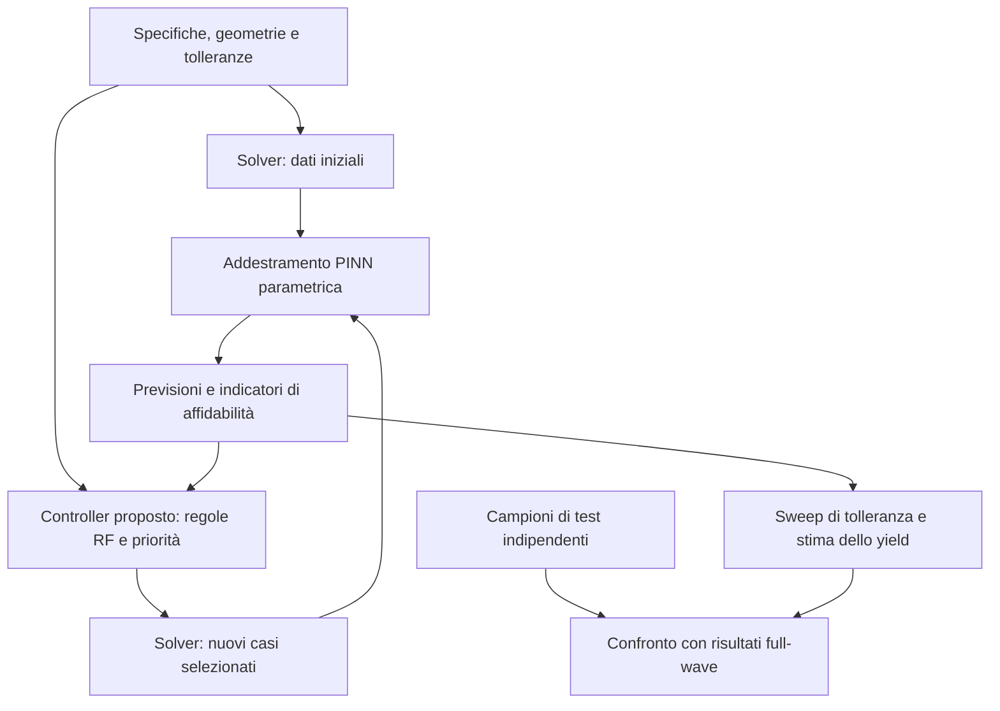
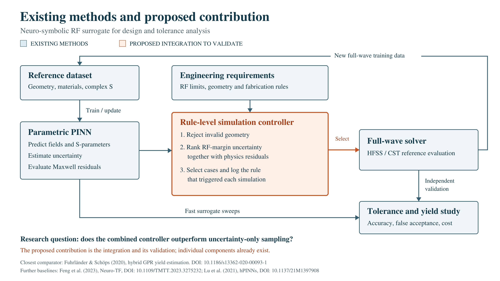
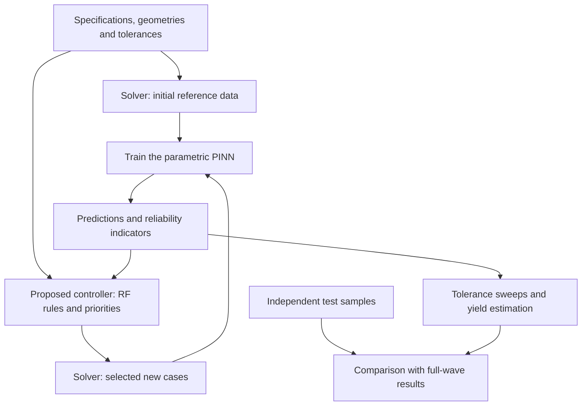

# Neuro-Symbolic RF Surrogates for Robust Filter Design

**Huawei TechArena 2026 - Sub-Topic 3: Applications of AI to the modelling of EM problems**

[Italiano](#italiano) · [English](#english) · [References / Bibliografia](#references)

> **Stato / Status:** proposta di ricerca da implementare e validare / research proposal awaiting implementation and validation. Questo README descrive il progetto previsto, non un software o un prototipo già funzionante. / This README describes the intended project, not an already working implementation or prototype.

## Italiano

### Percorso di lettura

1. [Il progetto in poche parole](#it-overview)
2. [Il dispositivo e i concetti di base](#it-basics)
3. [Il problema della progettazione e delle tolleranze](#it-problem)
4. [Le soluzioni esistenti](#it-existing)
5. [La proposta e il contributo da verificare](#it-proposal)
6. [Il workflow passo passo](#it-workflow)
7. [Come funzionano PINN e regole simboliche](#it-model)
8. [Perché l'approccio ha potenzialità](#it-potential)
9. [Cosa misurare e validare](#it-validation)
10. [Rischi, limiti e contromisure](#it-risks)
11. [Piano di implementazione e dati necessari](#it-plan)
12. [Glossario e domande frequenti](#it-glossary)

### 1. Il progetto in poche parole

Vogliamo progettare un filtro a radiofrequenza che funzioni bene anche quando la fabbricazione introduce piccole differenze nelle dimensioni o nei materiali.

Oggi possiamo verificare ogni variante con un simulatore elettromagnetico accurato. Il problema è il costo di ripetere questi calcoli molte volte. La proposta usa una rete neurale per valutare rapidamente numerose varianti e un insieme di regole esplicite per decidere quali casi richiedono una nuova simulazione di riferimento.

Il punto da studiare è questo:

> Possiamo scegliere meglio le nuove simulazioni combinando requisiti RF, incertezza delle previsioni e discrepanze rispetto alle equazioni di Maxwell, mantenendo un'accuratezza sufficiente e riducendo il costo totale?

La rete, le regole e il campionamento adattivo hanno precedenti. Il contributo candidato è la loro integrazione in un controller che registra anche **quale requisito e quale indicatore hanno motivato ogni nuova simulazione**. La sua utilità e la sua originalità specifica devono essere verificate.

### 2. Il dispositivo e i concetti di base

#### 2.1 Che cos'è un filtro RF?

Un filtro a radiofrequenza, o **RF**, lascia passare alcune frequenze e attenua le altre. Una radio offre un'analogia intuitiva: per ascoltare una stazione occorre distinguere il segnale desiderato dagli altri. Un filtro passabanda realizza una selezione in frequenza, pur non costituendo da solo un ricevitore completo.

Il dimostratore previsto è un **filtro microstrip a tre risonatori**: piste metalliche su un materiale isolante, con un piano di massa. I risonatori sono strutture che rispondono con particolare intensità in determinati intervalli di frequenza.

Nel primo esperimento la disposizione degli elementi, detta **topologia**, rimane fissa. Si modificano sei parametri geometrici: tre lunghezze, una larghezza comune e due distanze fra risonatori. Spessore del substrato e permittività sono ulteriori parametri del modello. Questa è una scelta di progetto proposta, ancora da confermare con i dati disponibili.

| Concetto | Significato semplice | Perché conta |
|---|---|---|
| Frequenza | Numero di oscillazioni al secondo, misurato in hertz | Determina quali segnali attraversano il filtro |
| Banda passante | Intervallo di frequenze da trasmettere | È una parte della specifica di progetto |
| Substrato | Materiale isolante che sostiene le piste | Influenza propagazione e perdite |
| Permittività | Proprietà che descrive la risposta elettrica del materiale | Può modificare le frequenze caratteristiche |
| Accoppiamento | Interazione elettromagnetica fra elementi | Influenza la forma della risposta |
| Perdite | Energia dissipata o non trasferita al carico desiderato | Riducono l'efficienza del dispositivo |

Per alcune strutture risonanti, un'intuizione utile è:

$$
f_0 \propto \frac{1}{L\sqrt{\varepsilon_{\mathrm{eff}}}}.
$$

Qui $L$ è una lunghezza caratteristica e $\varepsilon_{\mathrm{eff}}$ rappresenta l'effetto combinato dei materiali sulla propagazione. **È un'approssimazione, non la formula completa del filtro.** Suggerisce che una pista più lunga tende ad abbassare la frequenza di risonanza, a parità delle altre condizioni.

#### 2.2 Come descriviamo il comportamento del filtro?

Usiamo i **parametri di scattering**, o parametri **S**, che descrivono onde incidenti, riflesse e trasmesse alle porte del componente.

- $S_{11}$ descrive la riflessione alla porta di ingresso.
- $S_{21}$ descrive la trasmissione dall'ingresso all'uscita.
- La matrice S completa di un dispositivo a due porte comprende anche $S_{12}$ e $S_{22}$.

Sono quantità complesse: contengono **ampiezza e fase**. Nella banda utile desideriamo generalmente alta trasmissione e bassa riflessione. Nel progetto si modellano i valori complessi, non soltanto una curva di ampiezza.

In una configurazione con normalizzazione coerente delle porte:

$$
\mathrm{IL}=-20\log_{10}|S_{21}|,\qquad
\mathrm{RL}=-20\log_{10}|S_{11}|.
$$

IL indica l'insertion loss: nella banda utile, più bassa è generalmente meglio. RL indica il return loss: più alto significa meno riflessione. Occorre distinguere RL dalla curva $20\log_{10}|S_{11}|$, che ha segno opposto.

### 3. Il problema della progettazione e delle tolleranze

#### 3.1 Il metodo convenzionale

Un **solver full-wave** calcola il comportamento dei campi elettrici e magnetici risolvendo numericamente le equazioni di Maxwell. HFSS e CST sono esempi di strumenti utilizzabili.

Il processo tipico è:

1. Definire geometria, materiali, porte ed eccitazione.
2. Suddividere il dominio in elementi o celle: la **mesh**.
3. Calcolare la risposta su un insieme di frequenze.
4. Verificare se le specifiche sono rispettate.
5. Modificare le dimensioni e ripetere.

Il simulatore è un riferimento numerico, non una verità esatta: mesh, condizioni al contorno, modelli dei materiali e risoluzione in frequenza influenzano l'accuratezza. Prima di usarlo come riferimento occorre verificarne la convergenza.

#### 3.2 Perché non basta trovare un buon progetto nominale?

La fabbricazione produce variazioni: una pista può essere leggermente più larga, un gap più stretto, il substrato diverso dal valore nominale. Un progetto eccellente sulla carta può quindi non rispettare più i requisiti.

La **sensitività** descrive quanto cambia una risposta quando cambia un parametro. La **robustezza** riguarda il mantenimento delle prestazioni sotto variazioni. Lo **yield**, o resa, è la probabilità di rispettare tutte le specifiche considerate.

Con un'analisi **Monte Carlo** estraiamo molte varianti da distribuzioni di tolleranza e valutiamo ciascuna. Per esempio, 930 successi su 1.000 varianti danno una stima del 93%: è solo un esempio didattico, non un risultato del progetto.

$$
\widehat Y=\frac{1}{N}\sum_{i=1}^{N}\mathbf{1}\{\text{tutte le specifiche soddisfatte nella variante }i\}.
$$

Simulare ogni variante può richiedere un costo elevato. Inoltre, un piccolo errore della previsione vicino a una soglia RF può cambiare la decisione “conforme/non conforme”, anche se l'errore medio complessivo sembra basso.

### 4. Le soluzioni esistenti

Un **surrogate** è un modello approssimato, più rapido del simulatore che sostituisce in alcune valutazioni. È come costruire una mappa a partire da un insieme di misurazioni, invece di ripercorrere ogni volta tutto il territorio.

| Metodo | Come funziona | Punti da controllare |
|---|---|---|
| Modelli circuitali ed equivalenti | Semplificano il componente in elementi e relazioni fisiche | Le semplificazioni possono trascurare effetti EM rilevanti |
| Interpolazione / superfici di risposta | Approssimano la risposta fra esempi noti | Risonanze strette e molti parametri complicano il problema |
| Kriging / Gaussian Process Regression (GPR) | Predicono una risposta e un'incertezza dipendente dal modello | L'incertezza dipende dalle ipotesi e va verificata |
| FGSA e dominio ridotto | Identificano direzioni influenti e concentrano il modello in regioni utili | Regioni escluse o direzioni trascurate potrebbero contare per le tolleranze |
| Reti neurali supervisionate | Imparano dagli esempi la relazione fra input e risposta | Possono richiedere molti dati e generalizzare male fuori dominio |
| Neuro-TF | Collega reti neurali e rappresentazioni a funzione di trasferimento | Occorre identificare correttamente la struttura della risposta |
| PINN | Addestra una rete usando dati e residui di equazioni fisiche | Il training può essere difficile e la fisica non certifica automaticamente l'accuratezza |
| Approcci ibridi per lo yield | Usano il surrogate e rivalutano casi selezionati con il solver | La selezione dei casi e il controllo dell'errore sono essenziali |

**Quattro precedenti particolarmente rilevanti:**

- **[1] FGSA e pre-screening:** Koziel e Pietrenko-Dabrowska riducono e confinano il dominio del modello per migliorare la modellazione di componenti a microonde.
- **[2] Neuro-TF:** Feng e colleghi integrano informazioni di sensitività EM e feature nella progettazione di filtri con surrogate a funzione di trasferimento.
- **[3] GPR ibrido per lo yield:** Fuhrländer e Schöps valutano molti campioni Monte Carlo con un surrogate e rivalutano selettivamente quelli critici con il modello di alta fedeltà. È il precedente più vicino al nostro ciclo di verifica.
- **[4] hPINNs:** Lu e colleghi studiano inverse design con PINN e vincoli, con esempi in ottica e fluidodinamica. Questo non dimostra superiorità sui filtri microstrip.

Questi lavori non sono soluzioni universali, ma sono confronti obbligatori per valutare seriamente la proposta. **La rivalutazione selettiva con il solver non è una nostra invenzione.**

### 5. La proposta e il contributo da verificare

Il sistema proposto contiene tre parti:

| Parte | Compito | Stato rispetto alla letteratura |
|---|---|---|
| PINN parametrica | Prevedere campi e parametri S per una famiglia di geometrie | Principio esistente; implementazione RF da sviluppare |
| Regole simboliche | Rappresentare requisiti geometrici e RF in forma esplicita | Regole e vincoli sono concetti esistenti |
| Controller delle simulazioni | Usare margini dei requisiti, incertezza e residui fisici per scegliere nuove simulazioni e registrarne le motivazioni | Integrazione candidata da implementare, confrontare e verificare |

**Neuro-simbolico** significa qui che un modello neurale opera insieme a regole leggibili ed eseguibili. Non significa che la rete ragioni come una persona o che il sistema dimostri formalmente la correttezza del dispositivo. Il quadro generale ha precedenti nella letteratura neuro-simbolica [6].

La differenza candidata rispetto al workflow GPR di [3] è un controller che associa ogni decisione a un requisito RF identificabile e integra il residuo Maxwell nel criterio di selezione. Il confronto deve isolare questo contributo dalla semplice sostituzione del GPR con una rete.

Non rivendichiamo una nuova legge fisica, l'invenzione delle PINN o un metodo “mai usato prima”. **La combinazione specifica richiede ulteriori verifiche di anteriorità; la superiorità richiede esperimenti.** Anche aggiungere limiti di larghezza e gap a un ottimizzatore, da solo, non costituisce una novità scientifica.

### 6. Il workflow passo passo

**Passo 1 - Definire il problema.** Concordare banda, limiti RF, materiali, geometria e distribuzioni delle tolleranze. Fissare anche il budget computazionale.

**Passo 2 - Costruire un riferimento affidabile.** Generare esempi con il solver, controllando mesh e frequenze. Campionare lo spazio parametrico senza concentrarsi soltanto su un progetto favorevole.

**Passo 3 - Separare i dati.** Creare training set, validation set e test set per geometrie complete. Le frequenze della stessa geometria non devono finire sia nel training sia nel test.

**Passo 4 - Addestrare il surrogate.** La rete impara da risposte note e vincoli fisici. Il validation set serve a scegliere architettura e impostazioni; il test finale rimane separato.

**Passo 5 - Valutare nuovi candidati.** Per ciascuna geometria nominale si verificano prima le regole geometriche. Per i candidati ammissibili si stimano risposta, margini RF, incertezza e residui fisici.

**Passo 6 - Scegliere nuove simulazioni.** Il controller privilegia casi poco affidabili o vicini alle soglie, mantenendo anche una quota di esplorazione. Ogni richiesta conserva un motivo leggibile.

**Passo 7 - Aggiornare e misurare.** Le nuove simulazioni alimentano il training. Si confrontano i metodi con budget e criteri di accuratezza espliciti.

**Passo 8 - Studiare tolleranze e design.** Si usa il surrogate per molti sweep, si verifica lo yield con campioni indipendenti e si ottimizzano le dimensioni nominali. I progetti finali ritornano al solver; eventuali prototipi fisici sono una fase successiva.

> Scartare una geometria nominale impossibile durante l'ottimizzazione è corretto. Eliminare silenziosamente dal Monte Carlo le varianti produttive che falliscono falserebbe invece lo yield: vanno conteggiate coerentemente con la definizione di fallimento.

### 7. Come funzionano PINN e regole simboliche

#### 7.1 La PINN parametrica

Una rete ordinaria può imparare direttamente “geometria → parametri S”. La rete proposta rappresenta anche i campi, così da poter valutare direttamente le equazioni fisiche:

$$
(\mathbf r,f,\mathbf g,\mathbf m,p)
\longmapsto
(\widehat{\mathbf E},\widehat{\mathbf H}).
$$

- $\mathbf r$: posizione nello spazio;
- $f$: frequenza;
- $\mathbf g$: parametri geometrici;
- $\mathbf m$: proprietà dei materiali;
- $p$: porta eccitata;
- $\mathbf E,\mathbf H$: campi elettrico e magnetico complessi.

La proposta iniziale usa una rete fully connected (**MLP**) con **Fourier features**, cioè trasformazioni sinusoidali degli input che possono aiutare a rappresentare variazioni oscillanti. Rami distinti per aria e substrato permettono di trattare le interfacce; le condizioni di raccordo devono comunque essere imposte.

I parametri S si ricavano dai campi alle porte tramite proiezione sui modi di propagazione. Non basta leggere il campo in un punto: normalizzazione, eccitazione e piani di riferimento devono coincidere con il solver.

La funzione di errore da minimizzare può essere:

$$
\mathcal L=
\lambda_S\mathcal L_S+
\lambda_M\mathcal L_{Maxwell}+
\lambda_B\mathcal L_{bordi/interfacce}
+\lambda_F\mathcal L_{campi}.
$$

L'ultimo termine si usa se esistono campioni di campo etichettati. I termini vanno normalizzati e bilanciati, altrimenti uno può dominare gli altri soltanto per la scala numerica.

Un **residuo** è la discrepanza ottenuta sostituendo i campi previsti in un'equazione. In una regione senza sorgenti impresse, con convenzione temporale $e^{j\omega t}$, due residui sono:

$$
\mathbf r_E=\nabla\times\widehat{\mathbf E}+j\omega\mu\widehat{\mathbf H},
\qquad
\mathbf r_H=\nabla\times\widehat{\mathbf H}-(\sigma+j\omega\varepsilon)\widehat{\mathbf E}.
$$

Qui $\omega=2\pi f$, $\mu$ è la permeabilità, $\varepsilon$ la permittività e $\sigma$ la conducibilità. Si aggiungono condizioni fisiche e di bordo appropriate al problema. Un residuo basso nei punti controllati **non garantisce** un errore basso ovunque; contano anche campionamento, stabilità e condizioni ai bordi. Le difficoltà di training delle PINN sono documentate [5].

#### 7.2 Le regole simboliche

Una regola è un requisito con nome, ambito e criterio verificabile. Esempi concettuali:

| ID | Significato | Uso |
|---|---|---|
| `GEOM_MIN_GAP` | Distanza minima fra piste | Escludere candidati nominali non fabbricabili |
| `RF_PASSBAND_IL` | Perdita massima in banda | Calcolare quanto manca al limite |
| `RF_PASSBAND_RL` | Return loss minimo in banda | Identificare frequenze critiche |
| `RF_STOPBAND` | Attenuazione richiesta fuori banda | Individuare violazioni o incertezza |

I limiti reali vanno concordati. Un esempio **esclusivamente didattico**: con un massimo di 1,5 dB di insertion loss, una previsione di 1,4 dB ha un margine di appena 0,1 dB. Se la sua incertezza è comparabile al margine, è prudente richiedere una verifica full-wave.

Questo esempio non è una specifica Huawei e non rappresenta un intervallo statistico garantito.

#### 7.3 Il controller proposto

Un possibile criterio sperimentale di priorità è:

$$
a(\mathbf g)=
\max_j\frac{u_j(\mathbf g)}{|m_j(\mathbf g)|+\epsilon}
+\alpha\,\widetilde r_M(\mathbf g).
$$

$m_j$ è il margine normalizzato del requisito $j$, positivo quando conforme. $u_j$ indica l'incertezza di quel margine. $\widetilde r_M$ è un residuo fisico normalizzato, $\epsilon$ evita divisioni per zero e $\alpha$ bilancia i criteri. Per le regole su una banda si considera il margine peggiore sulla griglia di frequenze, con raffinamento se necessario.

Il rapporto incertezza/margine esprime una logica già nota nell'apprendimento attivo. **La formula è un'ipotesi operativa da confrontare, non una nuova formula dimostrata né un bound dell'errore.** Il contributo candidato riguarda l'integrazione con residui fisici e tracciamento dei requisiti.

Un ensemble di reti può stimare l'incertezza tramite il disaccordo fra modelli. Più reti concordi possono però sbagliare tutte: occorrono calibrazione e audit indipendenti. Il residuo si valuta anche su punti fisici non usati nel training.

### 8. Perché l'approccio ha potenzialità

| Meccanismo | Beneficio possibile | Condizione da verificare |
|---|---|---|
| Riutilizzo del surrogate | Molte valutazioni rapide dopo il training | Servono abbastanza valutazioni per ammortizzare il costo iniziale |
| Loss fisica | Riduzione delle soluzioni incompatibili con il problema | Training stabile e formulazione corretta |
| Regole geometriche | Meno valutazioni di candidati inutilizzabili | Regole corrette e non eccessivamente restrittive |
| Campionamento vicino ai requisiti | Dati concentrati dove cambiano le decisioni RF | Il criterio deve trovare davvero casi informativi |
| Residuo fisico nella priorità | Individuazione di casi trascurati dall'incertezza | Il residuo deve aggiungere informazione utile sull'errore |
| Registro delle decisioni | Esperimenti più riproducibili e interpretabili | Il registro deve descrivere il criterio reale, non spiegazioni inventate |

Un beneficio di ciascun componente è plausibile; non segue che la loro somma batta un buon GPR o Neuro-TF. Il controller e l'ensemble aggiungono costo.

$$
T_{totale}=T_{dati}+T_{training}+T_{ricerca}+T_{verifiche}.
$$

Il tempo di inferenza da solo non misura il vantaggio del progetto. Vanno riportati anche CPU/GPU, memoria e numero di riutilizzi necessario a raggiungere il pareggio.

### 9. Cosa misurare e validare

#### 9.1 Confronti necessari

Confrontare full-wave convenzionale, FGSA + Kriging, Neuro-TF, workflow GPR ibrido [3], PINN con acquisizione solo basata sull'incertezza e sistema completo. I metodi devono avere accesso ai dati dichiarato, dominio comparabile e regole geometriche coerenti.

Se non sono disponibili sensibilità EM, una baseline Neuro-TF semplificata va identificata come tale. Il costo di ottenere campi e sensitività rientra nel confronto. Usare più seed e budget crescenti, non una sola esecuzione favorevole.

#### 9.2 Metriche e target iniziali

**I valori seguenti sono obiettivi di ricerca proposti nel pitch, non risultati ottenuti né prestazioni garantite.**

| Metrica | Target iniziale | Riferimento |
|---|---|---|
| Errore relativo medio sulla matrice S complessa | ≤2% | Test full-wave indipendente |
| Errore assoluto sullo yield | ≤3 punti percentuali | Monte Carlo full-wave con precisione statistica adeguata |
| Numero di nuove chiamate full-wave | ≥50% in meno | Workflow GPR ibrido a qualità comparabile; target ambizioso |
| Tempo totale | ≥3× più rapido | Workflow full-wave convenzionale, includendo training e dati |
| Tempo di uno sweep dopo il training | ≥100× più rapido | Identico sweep full-wave; il solo costo online |

Una definizione esplicita dell'errore S è:

$$
E_S=\frac{100}{N}\sum_{i=1}^{N}
\frac{\|\widehat{\mathbf S}_i-\mathbf S_i^{FW}\|_F}
{\max(\|\mathbf S_i^{FW}\|_F,\epsilon_S)}.
$$

Per ogni geometria $i$, si aggregano tutte le frequenze e tutte le componenti S valutate. La norma è la radice della somma dei moduli al quadrato. $\epsilon_S$ è una soglia numerica prefissata e dichiarata. Evitare errori percentuali calcolati separatamente vicino agli zeri di una singola componente S.

L'errore medio va accompagnato da errori elevati/peggiori e dai **falsi accettati**: varianti previste conformi che il solver giudica non conformi. Specificare il denominatore delle percentuali: tutti i campioni oppure solo quelli previsti conformi.

Per lo yield, distinguere errore statistico Monte Carlo ed errore del surrogate. Un riferimento con intervalli di confidenza troppo ampi non può confermare un miglioramento di pochi punti percentuali.

#### 9.3 Esperimenti di rimozione dei componenti

Un'**ablation** rimuove un ingrediente mantenendo il resto il più possibile invariato:

1. Togliere la loss Maxwell per misurare il contributo della fisica al training.
2. Togliere il residuo dalla selezione per misurarne il valore nell'active learning.
3. Usare acquisizione solo basata sull'incertezza, mantenendo gli stessi vincoli geometrici.
4. Confrontare l'aggregazione per requisito con un criterio globale, e misurare separatamente l'utilità del registro decisionale.

L'audit non migliora automaticamente l'accuratezza: il suo beneficio può essere soprattutto la tracciabilità. Una conclusione negativa è comunque utile: se un metodo più semplice è migliore, va riportato.

### 10. Rischi, limiti e contromisure

| Rischio | Perché succede | Controllo previsto |
|---|---|---|
| PINN difficile da addestrare | Oscillazioni, interfacce e loss sbilanciate | Normalizzazione, campionamento mirato e benchmark semplice iniziale |
| Residuo basso ma risposta errata | Punti di controllo insufficienti o bordi modellati male | Residui su punti nuovi e confronto full-wave indipendente |
| Incertezza troppo ottimistica | Reti con errori comuni | Calibrazione, campioni casuali di audit, quota di esplorazione |
| Ottimizzazione che sfrutta errori del surrogate | La ricerca trova previsioni favorevoli ma scorrette | Verifica dei finalisti con il solver |
| Generalizzazione fuori dominio | Nuovi materiali o geometrie lontane dal training | Dominio dichiarato e ritorno al solver |
| Sensitività errate nonostante piccoli errori medi | Derivate più difficili da approssimare | Confronto con perturbazioni full-wave o sensitività di riferimento |
| Yield irrealistico | Distribuzioni produttive sbagliate o campioni esclusi impropriamente | Dati di processo, correlazioni esplicite e denominatore corretto |
| Costo totale maggiore dei baseline | Training, ensemble e controlli troppo costosi | Contabilità end-to-end e criterio di arresto |
| Divario fra simulazione e realtà | Materiali, connettori, rugosità o altri effetti trascurati | Misure su prototipi in una fase successiva |

La conformità ai vincoli geometrici può essere verificata esattamente entro la rappresentazione usata. La correttezza elettromagnetica continua a richiedere verifica numerica e, per il componente reale, sperimentale.

### 11. Piano di implementazione e dati necessari

| Fase | Attività | Risultato che abilita il passo successivo |
|---|---|---|
| 1. Specifiche | Fissare filtro, dominio, requisiti e tolleranze | Problema riproducibile e budget concordato |
| 2. Riferimento | Automatizzare il solver e verificarne la convergenza | Dataset coerente e test indipendente |
| 3. Baseline | Implementare modelli semplici e metodi pertinenti | Limite minimo di qualità/costo da superare |
| 4. PINN | Addestrare il modello di campi e validare i parametri S | Accuratezza sufficiente nel dominio |
| 5. Controller | Aggiungere regole, priorità e registro delle decisioni | Ciclo simulazione-training funzionante |
| 6. Benchmark | Studiare ablation, sensitività, yield e costi | Evidenza a favore o contro la proposta |
| 7. Dimostrazione | Ottimizzare e verificare un filtro | Progetto numericamente verificato; prototipo opzionale |

**Stack previsto:** Python/PyTorch per rete e derivate automatiche, un modulo Python per i predicati, scripting del solver disponibile per CAD e simulazioni, formati numerici aperti per dati e configurazioni. L'accesso a solver, licenze e risorse va confermato. Questo README non include ancora comandi di installazione perché non è stata implementata una pipeline eseguibile.

**Dati da richiedere:** parametri CAD e unità, geometrie ricostruibili, materiali anche dispersivi se rilevanti, definizioni e normalizzazioni delle porte, banda e griglia in frequenza, parametri S complessi, impostazioni di mesh e bordi, campioni di campo quando disponibili, distribuzioni e correlazioni delle tolleranze.

Il solo file dei parametri S non basta a definire il problema Maxwell. I campi etichettati sono utili ma opzionali in una loss ibrida; geometria, materiali ed eccitazione restano indispensabili.

**Uso su GitHub:** il README è autonomo e contiene diagrammi Mermaid. Non implica che codice, dataset o prototipi esistano già. Pubblicare soltanto materiale e dati per cui si dispone dell'autorizzazione; i documenti del mentor contrassegnati come riservati non sono inclusi qui. Prima di distribuire codice, scegliere una licenza: il README non ne assegna automaticamente una.

### 12. Glossario e domande frequenti

| Termine | Significato |
|---|---|
| EM | Elettromagnetico |
| Full-wave | Modellazione numerica dei campi con le equazioni di Maxwell |
| Surrogate | Modello approssimato usato per valutazioni rapide |
| PINN | Rete addestrata anche tramite equazioni fisiche |
| Parametrico | Condizionato da geometria/materiali, riutilizzabile entro un dominio |
| GPR / Kriging | Famiglia di modelli statistici per interpolazione e regressione |
| Neuro-TF | Rete neurale collegata a una rappresentazione a funzione di trasferimento |
| FGSA | Fast Global Sensitivity Analysis, analisi rapida delle direzioni influenti |
| Active learning | Scelta adattiva dei nuovi esempi da acquisire |
| Residuo | Discrepanza rispetto a un'equazione |
| Predicato | Regola valutabile su una geometria o una risposta |
| Ensemble | Insieme di modelli le cui previsioni vengono confrontate |
| Yield | Probabilità di rispettare tutte le specifiche considerate |
| Baseline | Metodo di riferimento con cui confrontare la proposta |
| Ablation | Esperimento che rimuove un componente per misurarne l'effetto |

**È tutto nuovo?** No. Le tecniche hanno precedenti; l'integrazione e il suo beneficio sono il contributo candidato.

**Una PINN risolve Maxwell esattamente?** Non in generale. Riduce residui e altri errori, con accuratezza da verificare.

**Perché una rete se ho già il solver?** Per ammortizzare il training su molte valutazioni. Con poche richieste potrebbe non convenire.

**Serve un LLM?** No. Il controller iniziale usa predicati e criteri numerici espliciti.

**Un residuo alto significa certamente risposta RF sbagliata?** No. È un indicatore da confrontare con l'errore reale; può essere scarsamente correlato alla quantità d'interesse.

**Esiste già un digital twin operativo?** No. La proposta riguarda un surrogate numerico; un gemello digitale operativo richiederebbe anche collegamento e aggiornamento con dati del dispositivo reale.

**Cosa conterebbe come successo?** Evidenza riproducibile di minore costo a qualità comparabile, più una descrizione chiara del dominio in cui il metodo è affidabile.

---

## English

### Reading path

1. [Project overview](#en-overview)
2. [The device and basic concepts](#en-basics)
3. [The design and tolerance problem](#en-problem)
4. [Existing solutions](#en-existing)
5. [The proposal and candidate contribution](#en-proposal)
6. [The workflow step by step](#en-workflow)
7. [How the PINN and symbolic rules work](#en-model)
8. [Why the approach has potential](#en-potential)
9. [What must be measured and validated](#en-validation)
10. [Risks, limitations and mitigations](#en-risks)
11. [Implementation plan and required data](#en-plan)
12. [Glossary and frequently asked questions](#en-glossary)

### 1. Project overview

We want to design a radio-frequency filter that performs well even when manufacturing introduces small differences in dimensions or materials.

Today, each variant can be checked with an accurate electromagnetic simulator. The challenge is the cost of repeating these calculations many times. The proposed system uses a neural network to evaluate many variants quickly and explicit rules to decide which cases require another reference simulation.

The research question is:

> Can we select more useful simulations by combining RF requirements, predictive uncertainty and discrepancies with Maxwell's equations, while maintaining sufficient accuracy and reducing total cost?

Neural networks, rules and adaptive sampling all have precedents. The candidate contribution is their integration into a controller that also records **which requirement and which indicator motivated each new simulation**. Its usefulness and specific originality remain to be established.

### 2. The device and basic concepts

#### 2.1 What is an RF filter?

A **radio-frequency (RF) filter** passes some frequencies and attenuates others. A radio is a useful analogy: receiving one station requires distinguishing the wanted signal from other signals. A band-pass filter provides frequency selection, although it is not a complete receiver by itself.

The planned demonstrator is a **three-resonator microstrip band-pass filter**: metal traces supported by an insulating substrate, with a ground plane. Resonators are structures that respond particularly strongly around certain frequencies.

The initial experiment keeps the arrangement of elements, or **topology**, fixed. Six geometry parameters vary: three resonator lengths, one shared trace width and two inter-resonator gaps. Substrate thickness and permittivity are additional model parameters. This is a proposed scope, subject to confirmation against available data.

| Concept | Plain explanation | Why it matters |
|---|---|---|
| Frequency | Oscillations per second, measured in hertz | Determines which signals pass through the filter |
| Passband | Frequency interval intended for transmission | Forms part of the design specification |
| Substrate | Insulating material supporting the traces | Affects propagation and losses |
| Permittivity | A material's electrical response property | Can shift characteristic frequencies |
| Coupling | Electromagnetic interaction between elements | Influences the response shape |
| Losses | Energy dissipated or not transferred to the intended load | Reduce device efficiency |

For some resonant structures, a useful approximation is:

$$
f_0 \propto \frac{1}{L\sqrt{\varepsilon_{\mathrm{eff}}}}.
$$

Here, $L$ is a characteristic length and $\varepsilon_{\mathrm{eff}}$ represents the combined effect of the surrounding materials on propagation. **This is an approximation, not the complete filter equation.** It suggests that a longer trace tends to lower the resonance frequency when other conditions are unchanged.

#### 2.2 How do we describe the filter response?

**Scattering parameters**, or **S-parameters**, describe incident, reflected and transmitted waves at the device ports.

- $S_{11}$ describes reflection at the input port.
- $S_{21}$ describes transmission from input to output.
- The full two-port S-matrix also contains $S_{12}$ and $S_{22}$.

They are complex quantities containing **magnitude and phase**. We generally want high transmission and low reflection in the passband. The project models complex values, not only magnitude curves.

With consistent port normalization:

$$
\mathrm{IL}=-20\log_{10}|S_{21}|,\qquad
\mathrm{RL}=-20\log_{10}|S_{11}|.
$$

IL is insertion loss: lower values are generally desirable in the passband. RL is return loss: higher values mean less reflection. RL must not be confused with $20\log_{10}|S_{11}|$, which has the opposite sign.

### 3. The design and tolerance problem

#### 3.1 The conventional approach

A **full-wave solver** calculates electric and magnetic fields by numerically solving Maxwell's equations. HFSS and CST are examples of tools that could be used.

A typical process is:

1. Define geometry, materials, ports and excitation.
2. Divide the domain into elements or cells: the **mesh**.
3. Calculate the response over a frequency grid.
4. Check whether the specifications are satisfied.
5. Adjust dimensions and repeat.

The solver is a numerical reference, not an exact truth. Its accuracy depends on the mesh, boundary conditions, material models and frequency resolution. Convergence checks are necessary before treating its results as reference data.

#### 3.2 Why is a good nominal design insufficient?

Manufacturing introduces variations: a trace may be wider, a gap narrower or a substrate property different from its nominal value. A design that performs well in its nominal configuration may then fail its requirements.

**Sensitivity** describes how much a response changes when a parameter changes. **Robustness** concerns preserving performance under variations. **Yield** is the probability of satisfying all the specifications being considered.

**Monte Carlo analysis** draws many variants from tolerance distributions and evaluates each one. For example, 930 successful variants out of 1,000 produce a 93% yield estimate. This is a teaching example, not a project result.

$$
\widehat Y=\frac{1}{N}\sum_{i=1}^{N}\mathbf{1}\{\text{all specifications are met by variant }i\}.
$$

Running a full-wave simulation for every variant can be expensive. A small prediction error near an RF limit can also reverse a pass/fail decision, even when average response error looks acceptable.

### 4. Existing solutions

A **surrogate** is an approximate model that is faster than the simulator it replaces for some evaluations. Think of building a map from a set of measurements instead of surveying the entire territory again for each question.

| Method | How it works | What must be checked |
|---|---|---|
| Circuit and equivalent models | Simplify a device into physical elements and relationships | Simplifications may omit relevant EM effects |
| Interpolation / response surfaces | Approximate responses between known examples | Narrow resonances and many parameters make modelling difficult |
| Kriging / Gaussian Process Regression (GPR) | Predict a response and model-dependent uncertainty | Uncertainty depends on assumptions and requires validation |
| FGSA and reduced domains | Identify influential directions and focus modelling on useful regions | Excluded regions or directions may still matter for tolerances |
| Supervised neural networks | Learn input-to-response relationships from examples | May need substantial data and fail outside the training domain |
| Neuro-TF | Combines neural networks with transfer-function representations | The response structure must be identified appropriately |
| PINNs | Train a network using data and physical-equation residuals | Training can be difficult; physics does not automatically certify accuracy |
| Hybrid yield methods | Use a surrogate and selectively re-evaluate samples with a solver | Sample selection and error control are essential |

**Four particularly relevant precedents:**

- **[1] FGSA and pre-screening:** Koziel and Pietrenko-Dabrowska reduce and confine the model domain to improve microwave-component modelling.
- **[2] Neuro-TF:** Feng and colleagues incorporate EM sensitivity information and response features into transfer-function surrogate optimization for filters.
- **[3] Hybrid GPR yield estimation:** Fuhrländer and Schöps evaluate many Monte Carlo samples with a surrogate and selectively re-evaluate critical samples with a high-fidelity model. This is the closest precedent for our verification loop.
- **[4] hPINNs:** Lu and colleagues investigate inverse design with PINNs and constraints, demonstrating optical and fluid-flow examples. This does not establish superiority for microstrip filters.

These are not universal solutions, but they are important comparisons for a credible assessment. **Selective solver re-evaluation is not an invention of this project.**

### 5. The proposal and candidate contribution

The proposed system has three parts:

| Part | Responsibility | Relationship to existing work |
|---|---|---|
| Parametric PINN | Predict fields and S-parameters across a family of geometries | Existing principle; RF implementation still to develop |
| Symbolic rules | Represent geometry and RF requirements explicitly | Rules and constraints are established concepts |
| Simulation controller | Use requirement margins, uncertainty and physics residuals to request new simulations and log their reasons | Candidate integration to implement, compare and validate |

Here, **neuro-symbolic** means a neural model operating together with readable, executable rules. It does not mean human-like reasoning or formal proof of device correctness. The general framework has precedents in neuro-symbolic research [6].

The candidate difference from the GPR workflow in [3] is a controller that ties decisions to identifiable RF requirements and incorporates Maxwell residuals into sample selection. Experiments must isolate this contribution from merely replacing a GPR model with a neural network.

We do not claim a new physical law, the invention of PINNs or an approach “never used before.” **The specific combination requires further prior-art investigation; superiority requires experiments.** Adding width and gap bounds to an optimizer alone would not constitute a scientific novelty.

### 6. The workflow step by step

**Step 1 - Define the problem.** Agree on the frequency band, RF limits, materials, geometry and tolerance distributions. Set a computational budget.

**Step 2 - Build a reliable reference.** Generate solver examples after checking mesh and frequency convergence. Sample the parameter domain rather than only one favourable design region.

**Step 3 - Separate the data.** Create training, validation and test sets using complete geometries. Frequencies from the same geometry must not appear in both training and test sets.

**Step 4 - Train the surrogate.** Learn from known responses and physical constraints. Use validation data for architecture and configuration choices; keep the final test set separate.

**Step 5 - Evaluate new candidates.** First check the geometry rules for each nominal design. For feasible candidates, estimate responses, RF margins, uncertainty and physics residuals.

**Step 6 - Select new simulations.** Prioritize unreliable cases or cases near RF limits while retaining an exploration quota. Each simulation request records a readable reason.

**Step 7 - Update and measure.** Add new simulation results to the training data. Compare methods under explicit budgets and accuracy criteria.

**Step 8 - Study tolerances and design.** Use the surrogate for many sweeps, check yield on independent samples and optimize nominal dimensions. Verify final designs with the solver. Physical prototypes can follow later.

> Rejecting an impossible nominal geometry during optimization is appropriate. Silently removing failing manufacturing variants from Monte Carlo analysis would bias yield estimates: count them consistently with the declared failure definition.

### 7. How the PINN and symbolic rules work

#### 7.1 The parametric PINN

An ordinary neural network can learn “geometry → S-parameters” directly. The proposed network also represents fields, allowing explicit evaluation of physical equations:

$$
(\mathbf r,f,\mathbf g,\mathbf m,p)
\longmapsto
(\widehat{\mathbf E},\widehat{\mathbf H}).
$$

- $\mathbf r$: spatial position;
- $f$: frequency;
- $\mathbf g$: geometry parameters;
- $\mathbf m$: material properties;
- $p$: excited port;
- $\mathbf E,\mathbf H$: complex electric and magnetic fields.

The initial proposal uses a fully connected network (**MLP**) with **Fourier features**: sinusoidal input transformations that may help represent oscillatory behaviour. Separate air and substrate branches allow interface treatment, but the appropriate interface conditions must still be imposed.

S-parameters are obtained by projecting port fields onto propagation modes. Reading a field at a single point is insufficient: normalization, excitation and reference planes must match the solver.

A possible training objective is:

$$
\mathcal L=
\lambda_S\mathcal L_S+
\lambda_M\mathcal L_{Maxwell}+
\lambda_B\mathcal L_{boundaries/interfaces}
+\lambda_F\mathcal L_{fields}.
$$

The final term is used when labelled field samples exist. Terms must be normalized and balanced; otherwise, one may dominate simply because of its numerical scale.

A **residual** is the discrepancy obtained by substituting predicted fields into an equation. In a region without impressed sources, using the time convention $e^{j\omega t}$, two residuals are:

$$
\mathbf r_E=\nabla\times\widehat{\mathbf E}+j\omega\mu\widehat{\mathbf H},
\qquad
\mathbf r_H=\nabla\times\widehat{\mathbf H}-(\sigma+j\omega\varepsilon)\widehat{\mathbf E}.
$$

Here, $\omega=2\pi f$, $\mu$ is permeability, $\varepsilon$ is permittivity and $\sigma$ is conductivity. Additional physical and boundary conditions must match the problem. A small residual at sampled points **does not guarantee** small error everywhere; sampling, stability and boundary conditions also matter. PINN training difficulties are documented [5].

#### 7.2 Symbolic rules

A rule is a requirement with an identifier, scope and evaluable criterion. Conceptual examples:

| ID | Meaning | Use |
|---|---|---|
| `GEOM_MIN_GAP` | Minimum spacing between traces | Reject unmanufacturable nominal candidates |
| `RF_PASSBAND_IL` | Maximum passband insertion loss | Measure distance to the limit |
| `RF_PASSBAND_RL` | Minimum passband return loss | Identify critical frequencies |
| `RF_STOPBAND` | Required out-of-band attenuation | Detect violations or uncertainty |

Actual limits must be agreed. A **teaching-only example**: with a maximum insertion loss of 1.5 dB, a 1.4 dB prediction has only 0.1 dB of margin. If uncertainty is comparable to that margin, a full-wave check is advisable.

This is not a Huawei specification and does not imply a statistically guaranteed interval.

#### 7.3 The proposed controller

A possible experimental priority score is:

$$
a(\mathbf g)=
\max_j\frac{u_j(\mathbf g)}{|m_j(\mathbf g)|+\epsilon}
+\alpha\,\widetilde r_M(\mathbf g).
$$

$m_j$ is the normalized margin for requirement $j$, positive when satisfied. $u_j$ measures uncertainty in that margin. $\widetilde r_M$ is a normalized physics residual, $\epsilon$ prevents division by zero and $\alpha$ balances the criteria. For band-wide rules, use the worst margin across the frequency grid and refine that grid when necessary.

The uncertainty-to-margin ratio expresses an established active-learning idea. **This is an operational hypothesis to compare, not a proven new formula or an error bound.** The candidate contribution concerns its integration with physics residuals and requirement-level traceability.

An ensemble can estimate uncertainty through disagreement between separately trained networks. Multiple networks can still agree and be wrong, so calibration and independent audits are necessary. Physics residuals should also be evaluated at points not used for training.

### 8. Why the approach has potential

| Mechanism | Possible benefit | Condition to validate |
|---|---|---|
| Surrogate reuse | Many fast evaluations after training | Enough evaluations to amortize initial cost |
| Physics loss | Fewer solutions inconsistent with the physical problem | Stable training and correct formulation |
| Geometry rules | Fewer evaluations of unusable nominal designs | Correct rules that do not overrestrict the search |
| Sampling near requirement limits | More data where RF decisions change | The selection criterion must find informative cases |
| Physics residual in the priority score | Detection of cases missed by uncertainty estimates | The residual must provide useful extra information about error |
| Decision log | More reproducible and interpretable experiments | Logs must reflect the actual criterion, not invented explanations |

Each mechanism has a plausible benefit. Their combination does not automatically outperform a strong GPR or Neuro-TF baseline. The controller and ensemble also add computational cost.

$$
T_{total}=T_{data}+T_{training}+T_{search}+T_{verification}.
$$

Inference time alone is insufficient. Report CPU/GPU usage, memory and the number of model reuses needed to break even.

### 9. What must be measured and validated

#### 9.1 Required comparisons

Compare conventional full-wave workflows, FGSA + Kriging, Neuro-TF, hybrid GPR yield estimation [3], a PINN with uncertainty-only acquisition and the complete system. Declare each method's data access, use comparable domains and apply consistent geometry rules.

If EM sensitivities are unavailable, label any simplified Neuro-TF implementation accordingly. Count the cost of obtaining fields and sensitivities. Use multiple random seeds and increasing budgets, rather than reporting one favourable run.

#### 9.2 Metrics and initial targets

**These numbers are research targets proposed in the pitch, not measured results or performance guarantees.**

| Metric | Initial target | Reference |
|---|---|---|
| Mean relative complex S-matrix error | ≤2% | Independent full-wave test set |
| Absolute yield error | ≤3 percentage points | Full-wave Monte Carlo with adequate statistical precision |
| New full-wave calls | ≥50% fewer | Hybrid GPR at comparable quality; an ambitious target |
| Total time | ≥3× faster | Conventional full-wave workflow, including training and data generation |
| Sweep time after training | ≥100× faster | Identical full-wave sweep; online cost only |

An explicit definition of S-error is:

$$
E_S=\frac{100}{N}\sum_{i=1}^{N}
\frac{\|\widehat{\mathbf S}_i-\mathbf S_i^{FW}\|_F}
{\max(\|\mathbf S_i^{FW}\|_F,\epsilon_S)}.
$$

For each geometry $i$, aggregate all evaluated frequencies and S-matrix entries. The norm is the square root of the sum of squared magnitudes. $\epsilon_S$ is a predetermined and documented numerical floor. Avoid separate percentage errors near zeros of individual S-parameters.

Complement average error with high-percentile/worst errors and **false acceptance**: variants predicted to pass that fail in the solver. State the denominator of any percentage, such as all samples or only predicted-pass samples.

For yield, separate Monte Carlo statistical error from surrogate error. A reference estimate with broad confidence intervals cannot verify improvements of only a few percentage points.

#### 9.3 Component-removal experiments

An **ablation** removes one ingredient while holding the rest as constant as possible:

1. Remove the Maxwell loss to measure the benefit of physics during training.
2. Remove the residual from sample selection to measure its active-learning value.
3. Use uncertainty-only acquisition while retaining identical geometry constraints.
4. Compare requirement-level aggregation with a global criterion, and evaluate the decision log separately.

Logging does not automatically improve prediction accuracy: its value may primarily be traceability. Negative findings are informative. If a simpler method is better, report that result.

### 10. Risks, limitations and mitigations

| Risk | Why it occurs | Planned control |
|---|---|---|
| Difficult PINN training | Oscillations, interfaces and unbalanced loss terms | Normalization, targeted sampling and a simple initial benchmark |
| Small residual but wrong response | Insufficient control points or incorrect boundaries | Residual checks on new points and independent full-wave validation |
| Overconfident uncertainty | Shared errors across networks | Calibration, random audit samples and exploration |
| Optimization exploits surrogate errors | Search discovers favourable but incorrect predictions | Solver verification of finalists |
| Out-of-domain failure | New materials or geometries far from training data | Explicit domain and solver fallback |
| Wrong sensitivities despite small average error | Derivatives are harder to approximate accurately | Comparison with full-wave perturbations or reference sensitivities |
| Unrealistic yield | Wrong manufacturing distributions or improperly excluded samples | Process data, explicit correlations and correct denominators |
| Higher total cost than baselines | Expensive training, ensembles and checks | End-to-end accounting and stopping criteria |
| Simulation-to-reality gap | Unmodelled material, connector, roughness or other effects | Physical prototype measurements in a later phase |

Geometry constraints can be checked exactly within their encoded representation. Electromagnetic correctness still requires numerical verification and, for a real device, experimental validation.

### 11. Implementation plan and required data

| Phase | Work | Evidence needed to proceed |
|---|---|---|
| 1. Specifications | Define filter, domain, requirements and tolerances | Reproducible problem and agreed budget |
| 2. Reference | Automate the solver and check convergence | Consistent data and independent test set |
| 3. Baselines | Implement simple and relevant existing models | Quality/cost performance to improve upon |
| 4. PINN | Train the field model and validate S-parameters | Sufficient in-domain accuracy |
| 5. Controller | Add rules, priorities and decision logging | Working simulation-training loop |
| 6. Benchmark | Evaluate ablations, sensitivities, yield and costs | Evidence for or against the proposal |
| 7. Demonstration | Optimize and verify one filter | Numerically verified design; optional physical prototype |

**Planned stack:** Python/PyTorch for networks and automatic differentiation, a Python predicate module, scripting for the available solver, and open numerical formats for data and configurations. Solver access, licences and compute resources must be confirmed. Installation commands are intentionally absent because an executable pipeline has not yet been implemented.

**Required data:** CAD parameters and units, reconstructible geometries, material properties including dispersion where relevant, port definitions and normalization, frequency band and grid, complex S-parameters, mesh and boundary settings, field samples when available, and tolerance distributions/correlations.

An S-parameter file alone does not define the Maxwell problem. Labelled fields are useful but optional in a hybrid loss; geometry, materials and excitation remain essential.

**GitHub use:** this README is self-contained and includes Mermaid diagrams. It does not imply that implementation code, datasets or prototypes already exist. Publish only materials and data you are authorized to distribute; the mentor's restricted documents are not included here. Choose a licence before distributing code: this README does not automatically assign one.

### 12. Glossary and frequently asked questions

| Term | Meaning |
|---|---|
| EM | Electromagnetic |
| Full-wave | Numerical field modelling using Maxwell's equations |
| Surrogate | Approximate model used for fast evaluations |
| PINN | Neural network trained partly through physical equations |
| Parametric | Conditioned on geometry/materials and reusable within a domain |
| GPR / Kriging | Related statistical approaches to interpolation and regression |
| Neuro-TF | Neural network linked to a transfer-function representation |
| FGSA | Fast Global Sensitivity Analysis of influential directions |
| Active learning | Adaptive selection of new examples to acquire |
| Residual | Discrepancy with an equation |
| Predicate | Evaluable rule about a geometry or response |
| Ensemble | Multiple models whose predictions are compared |
| Yield | Probability of satisfying all considered specifications |
| Baseline | Reference method used for comparison |
| Ablation | Experiment removing a component to measure its effect |

**Is everything new?** No. The techniques have precedents; the integration and its benefits are the candidate contribution.

**Does a PINN solve Maxwell's equations exactly?** Not in general. It minimizes residuals and other errors, with accuracy to be validated.

**Why use a network when a solver already exists?** To amortize training over many evaluations. For only a few queries, it may not be worthwhile.

**Is an LLM required?** No. The initial controller uses explicit predicates and numerical criteria.

**Does a high physics residual necessarily mean an incorrect RF response?** No. It is an indicator to compare against actual error and may correlate poorly with the quantity of interest.

**Is there already an operational digital twin?** No. This proposal concerns a numerical surrogate. An operational digital twin would also require a connection to and updating from real-device data.

**What would count as success?** Reproducible evidence of reduced cost at comparable quality, with an explicit description of the domain where the method is reliable.

---

## References / Bibliografia

The references support the existing methods and their limitations. They do not establish the performance or originality of the proposed integration. / I riferimenti documentano metodi esistenti e limiti; non dimostrano prestazioni o originalità dell'integrazione proposta.

**[1]** S. Koziel and A. Pietrenko-Dabrowska. “Accurate modeling of microwave structures in constrained domains using global sensitivity analysis and performance-based pre-screening.” *Scientific Reports* **15**, 43073 (2025). [DOI: 10.1038/s41598-025-27085-8](https://doi.org/10.1038/s41598-025-27085-8).

**[2]** F. Feng et al. “Feature and EM Sensitivity Co-Assisted Neuro-TF Surrogate Optimization for Microwave Filter Design.” *IEEE Transactions on Microwave Theory and Techniques* **71**(11), 4749–4761 (2023). [DOI: 10.1109/TMTT.2023.3275232](https://doi.org/10.1109/TMTT.2023.3275232).

**[3]** M. Fuhrländer and S. Schöps. “A blackbox yield estimation workflow with Gaussian process regression applied to the design of electromagnetic devices.” *Journal of Mathematics in Industry* **10**, 25 (2020). [DOI: 10.1186/s13362-020-00093-1](https://doi.org/10.1186/s13362-020-00093-1) · [Open manuscript](https://arxiv.org/abs/2003.13278).

**[4]** L. Lu, R. Pestourie, W. Yao, Z. Wang, F. Verdugo and S. G. Johnson. “Physics-Informed Neural Networks with Hard Constraints for Inverse Design.” *SIAM Journal on Scientific Computing* **43**(6), B1105–B1132 (2021). [DOI: 10.1137/21M1397908](https://doi.org/10.1137/21M1397908) · [Open manuscript](https://arxiv.org/abs/2102.04626).

**[5]** A. S. Krishnapriyan, A. Gholami, S. Zhe, R. M. Kirby and M. W. Mahoney. “Characterizing possible failure modes in physics-informed neural networks.” *NeurIPS* (2021). [Open manuscript](https://arxiv.org/abs/2109.01050).

**[6]** J. J. Sun et al. “Neurosymbolic Programming for Science.” Discussion paper / arXiv preprint (2022). [Open manuscript](https://arxiv.org/abs/2210.05050).

**Document scope / Ambito del documento:** introductory research proposal, based on selected literature available on 28 September 2026. This is not an exhaustive systematic review or a patentability assessment. / Proposta introduttiva basata su letteratura selezionata disponibile al 28 settembre 2026. Non è una revisione sistematica esaustiva né una valutazione di brevettabilità.
