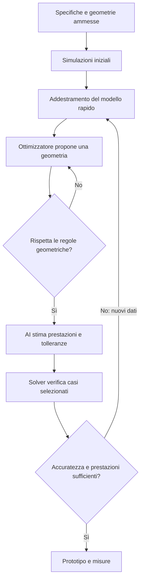
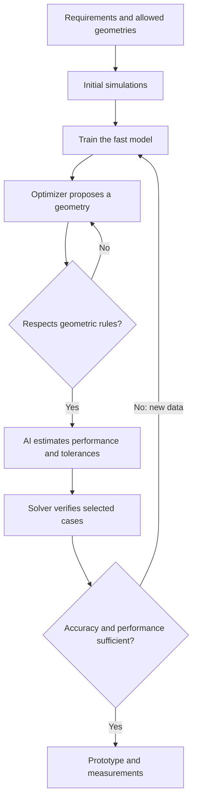

**La proposta ha una logica scientifica plausibile, ma non abbiamo ancora dimostrato che funzioni sul nostro filtro RF.** Il deck descrive un progetto di ricerca: i vantaggi numerici sono obiettivi da verificare.

Nella risposta precedente ho introdotto troppo rapidamente diversi concetti. Partiamo dal problema fisico, poi vediamo cosa aggiunge ciascuna tecnologia.

**1. Che cosa vogliamo costruire?**

Un **filtro a radiofrequenza**, cioè un componente che lascia passare determinate frequenze e attenua le altre.

Immagina di voler ricevere una stazione radio: il filtro aiuta a selezionare la parte di segnale che interessa. Nel nostro caso è un circuito formato da piste metalliche su un materiale isolante, chiamato *substrato*. Questa tecnologia si chiama **microstrip**.

Il suo comportamento dipende da:

| Elemento | Effetto sul dispositivo |
|---|---|
| Lunghezza delle piste | Influenza le frequenze di risonanza |
| Distanza tra piste | Influenza quanto interagiscono e la banda del filtro |
| Materiale isolante | Influenza la propagazione del campo |
| Perdite nei materiali | Riducono la potenza utile trasmessa |

Per alcune strutture risonanti, una relazione **approssimata** è:

\[
f_{\mathrm{risonanza}}\propto \frac{1}{L\sqrt{\varepsilon_{\mathrm{eff}}}}
\]

Qui \(L\) è una lunghezza caratteristica e \(\varepsilon_{\mathrm{eff}}\) rappresenta l’effetto del materiale sulla propagazione.

Tenendo fisso il materiale, una lunghezza maggiore tende quindi ad abbassare la frequenza. Nel modello semplificato, un aumento dell’1% di \(L\) produce circa una diminuzione dell’1% della frequenza.

Questo spiega già un problema concreto: **un piccolo errore di fabbricazione può spostare la risposta del filtro.**

---

**2. Come si progetta senza AI?**

Si disegna una geometria e si usa un **simulatore elettromagnetico**, detto anche *solver*, per calcolare come si comportano i campi elettrici e magnetici.

Il solver risolve numericamente le **equazioni di Maxwell**, che descrivono le relazioni fra campi, cariche e correnti. Servono anche materiali, eccitazione e condizioni ai bordi del dominio.

Il progettista modifica le dimensioni e ripete la simulazione finché la risposta soddisfa le specifiche.

Due risultati importanti sono:

- **\(S_{21}\):** descrive la trasmissione del segnale dall’ingresso all’uscita.
- **\(S_{11}\):** descrive la riflessione del segnale verso l’ingresso.

Nella banda utile vogliamo, generalmente, molta trasmissione e poca riflessione.

**Perché cercare un altro metodo?** Una simulazione può essere costosa, soprattutto quando devi ripeterla per molte geometrie e variazioni produttive. Anche il solver è un’approssimazione: la sua accuratezza dipende dalla discretizzazione, dai materiali e dalle condizioni impostate.

---

**3. Il workflow completo**

Il sistema avrebbe due momenti: prima costruisce un modello rapido, poi lo usa per cercare progetti migliori.

Vediamo cosa significa ciascuna parte dell’AI.

**4. La rete neurale: imparare una scorciatoia**

Una **rete neurale** è una funzione matematica con molti parametri regolabili. Durante l’addestramento, questi parametri cambiano per ridurre gli errori sulle risposte previste.

Nel nostro caso:

\[
\text{geometria + materiali + frequenza}
\quad\longmapsto\quad
\text{risposta elettromagnetica prevista}
\]

Le simulazioni iniziali forniscono esempi di questa relazione. Dopo l’addestramento, la rete può stimare nuove risposte senza ripetere tutti i calcoli del solver.

Si chiama **surrogate**, cioè modello sostitutivo approssimato.

**Perché potrebbe funzionare?** Se consideriamo una famiglia limitata di geometrie, la relazione fra parametri e risposta contiene strutture regolari che un modello può apprendere. Esistono applicazioni pubblicate di surrogate neurali all’inverse design elettromagnetico, anche tridimensionale. Questo dimostra la fattibilità dell’approccio in determinati casi, non l’efficacia automatica sul nostro filtro. :chatgpt-content-reference{index="0"}

**Problema principale:** una rete può essere precisa sulle geometrie simili a quelle studiate e sbagliare molto su geometrie diverse. Per questo dichiariamo un intervallo di utilizzo e verifichiamo geometrie mai usate nel training.

---

**5. La PINN: insegnare anche la fisica**

Una **Physics-Informed Neural Network**, o PINN, viene addestrata tenendo conto sia dei dati sia delle equazioni fisiche.

Per applicare direttamente Maxwell, la rete deve rappresentare i campi elettrici e magnetici, non soltanto produrre un numero finale come la frequenza centrale.

La funzione da minimizzare, detta *loss*, può avere questa struttura:

\[
\mathcal{L}
=
\lambda_d\,\mathcal{L}_{dati}
+
\lambda_M\,\mathcal{L}_{Maxwell}
+
\lambda_b\,\mathcal{L}_{bordi}
\]

| Termine | Domanda a cui risponde |
|---|---|
| Errore sui dati | Le previsioni coincidono con le simulazioni disponibili? |
| Errore su Maxwell | I campi previsti rispettano le equazioni nei punti controllati? |
| Errore ai bordi | Il modello rispetta porte, superfici e interfacce? |

I coefficienti \(\lambda\) bilanciano l’importanza dei termini, dopo opportuna normalizzazione.

**Perché potrebbe aiutare?** Molte funzioni possono riprodurre pochi esempi. Le equazioni fisiche restringono le possibilità e possono guidare l’apprendimento anche dove mancano dati.

**Perché non è una garanzia?** Una rete può ridurre alcuni errori trascurandone altri. Inoltre, rispettare le equazioni in un insieme di punti non significa risolvere accuratamente tutto il problema. La letteratura documenta difficoltà di ottimizzazione delle PINN anche su equazioni relativamente semplici. :chatgpt-content-reference{index="1"}

Nel nostro progetto, **il beneficio della PINN va confrontato sperimentalmente con una rete addestrata soltanto sui dati.**

---

**6. La parte simbolica: regole esplicite di progetto**

La componente **simbolica** rappresenta conoscenza tramite regole, relazioni e vincoli leggibili.

Esempi:

- la larghezza di una pista deve superare il minimo produttivo;
- due elementi devono avere una determinata connessione;
- il circuito deve stare nell’area disponibile;
- il materiale deve appartenere a un catalogo ammesso.

Una regola elementare potrebbe essere:

\[
\text{larghezza della pista}\geq \text{minimo fabbricabile}
\]

L’integrazione di modelli neurali con conoscenza strutturata è il principio generale della programmazione neuro-simbolica. :chatgpt-content-reference{index="2"}

**Perché aiuta?** Esclude candidati che sarebbero inutili prima di spendere tempo per valutarli.

Ma occorre essere precisi su quanto questo sia innovativo: **aggiungere semplici limiti numerici a un ottimizzatore è già pratica comune.** La proposta diventa più interessante se la componente simbolica gestisce anche una grammatica delle strutture, connessioni e scelte discrete, interagendo con il modello neurale.

**Problema principale:** regole troppo restrittive possono escludere progetti validi e migliori. E una geometria fabbricabile può comunque avere pessime prestazioni RF.

---

**7. Active learning e robustezza: dove spendere i calcoli**

L’**active learning** consiste nello scegliere quali nuovi esempi vale la pena calcolare con il solver.

Se il modello conosce già bene una regione, ulteriori simulazioni simili possono aggiungere poco. Conviene investigare anche:

- geometrie promettenti;
- zone con pochi dati;
- casi vicini al limite fra successo e fallimento.

Un *ensemble*, cioè più reti addestrate separatamente, può fornire un indizio di incertezza: se le reti discordano, il caso merita attenzione. **Se concordano, però, potrebbero comunque sbagliare tutte nello stesso modo.**

Poi studiamo la **robustezza produttiva**: per una geometria scelta, introduciamo molte piccole variazioni plausibili e stimiamo quante versioni continuano a rispettare le specifiche.

\[
\widehat{\text{yield}}
=
\frac{\text{varianti che rispettano tutte le specifiche}}
{\text{varianti valutate}}
\]

Esempio puramente didattico: 930 successi su 1.000 varianti danno una stima del 93%.

Questa stima ha due fonti diverse di errore:

1. **Errore statistico:** abbiamo provato un numero finito di varianti.
2. **Errore del surrogate:** alcune varianti potrebbero essere classificate male.

Aumentare le valutazioni della rete riduce il primo problema, ma **non elimina il secondo**. Servono controlli indipendenti con il solver e, per verificare il dispositivo reale, misure su prototipi.

---

**8. Quando conviene davvero?**

Il tempo dell’AI va contato interamente:

\[
T_{\mathrm{AI}}
=
T_{\mathrm{dati}}
+
T_{\mathrm{training}}
+
T_{\mathrm{ricerca}}
+
T_{\mathrm{verifiche}}
\]

Se servono poche valutazioni, costruire il surrogate potrebbe costare più delle simulazioni che risparmia. Il vantaggio emerge quando il modello viene riutilizzato abbastanza.

Anche qui la velocità va confrontata **a parità di qualità del risultato**, non soltanto confrontando il tempo di una previsione con quello di una simulazione.

| Rischio | Come lo verifichiamo |
|---|---|
| La PINN costa più di quanto faccia risparmiare | Misuriamo il tempo totale, incluso training |
| L’ottimizzatore sfrutta errori della rete | Verifichiamo i candidati migliori con il solver |
| Le regole eliminano buone soluzioni | Confrontiamo la ricerca con e senza regole |
| Il modello sbaglia vicino alle soglie | Testiamo specificamente quelle regioni |
| Le tolleranze ipotizzate sono irrealistiche | Usiamo dati di processo o dichiariamo le ipotesi |
| Il filtro simulato differisce da quello reale | Fabbrichiamo e misuriamo prototipi |

**Il primo esperimento che farei è piccolo:** una sola famiglia di filtri, pochi parametri geometrici e un solver di riferimento verificato. Confronterei un modello semplice, una rete neurale e una PINN sugli stessi dati. Aggiungerei poi regole simboliche e active learning, misurando il contributo di ogni elemento.

La domanda scientifica del progetto diventa quindi: **“Quali di questi componenti riducono realmente il costo per ottenere un filtro accuratamente verificato e robusto?”** È una domanda a cui possiamo rispondere con esperimenti riproducibili.

**Non è un approccio totalmente nuovo, e non ho copiato la proposta da un singolo progetto.** Ho combinato metodi già presenti nella letteratura, adattandoli al bando. La definizione corretta, al momento, è **proposta di integrazione da sviluppare e validare**.

Devo anche precisare un limite del lavoro svolto: **ho verificato la plausibilità tecnica, ma non ho effettuato una ricerca sistematica di anteriorità**. Non possiamo quindi affermare che nessuno abbia già realizzato una combinazione molto simile.

| Elemento della proposta | Situazione |
|---|---|
| Reti neurali come surrogate di simulatori EM | Già utilizzate |
| Inverse design elettromagnetico tramite AI | Già utilizzato |
| PINN e neural operator | Metodi già esistenti |
| Vincoli geometrici e produttivi nell’ottimizzazione | Pratica consolidata |
| Active learning e analisi delle tolleranze | Metodi già esistenti |
| Integrazione specifica proposta per il filtro | Novità **non ancora accertata** |

Per esempio, il lavoro di Augenstein e colleghi utilizza già un neural operator come surrogate per l’inverse design elettromagnetico tridimensionale. Sarebbe quindi scorretto presentare quella parte come una nostra invenzione. :chatgpt-content-reference{index="0"} Anche l’idea generale di combinare reti neurali e conoscenza simbolica precede questa proposta. :chatgpt-content-reference{index="1"}

**Usare tecniche esistenti, citandole, non significa copiare.** Molta ricerca introduce un metodo migliore per combinarle, risolve un problema prima non affrontato oppure dimostra un vantaggio che prima non era documentato. Però mettere insieme diverse tecnologie non costituisce automaticamente un contributo originale.

Nel nostro caso, una possibile direzione originale sarebbe:

> Studiare un sistema in cui regole esplicite sulla struttura e sulla fabbricazione guidano sia la generazione delle geometrie sia la scelta delle nuove simulazioni, per migliorare la robustezza produttiva con un budget limitato.

Anche questa è **un’ipotesi di contributo**, non una novità dimostrata. Per sostenerla dovremmo:

1. Cercare lavori vicini su filtri RF, progettazione neuro-simbolica e ottimizzazione delle tolleranze.
2. Identificare una differenza precisa nel nostro algoritmo.
3. Dimostrare con esperimenti che quella differenza produce un beneficio rispetto ai metodi esistenti.

**Il deck attuale presenta una proposta tecnicamente motivata, ma non dimostra originalità scientifica.** Avrei dovuto rendere questa distinzione più esplicita fin dall’inizio. Prima di presentarla come innovazione, il passo necessario è confrontarla con i lavori più vicini e definire esattamente quale contributo vogliamo rivendicare.

---

# English version

**The proposal has a scientifically plausible logic, but we have not yet demonstrated that it works on our RF filter.** The deck describes a research project: the numerical advantages are objectives to be verified.

The previous response introduced several concepts too quickly. Let us start from the physical problem, then we will see what each technology adds.

**1. What do we want to build?**

A **radio-frequency filter**, i.e., a component that allows some frequencies to pass while attenuating others.

Imagine wanting to receive a radio station: the filter helps select the part of the signal that matters. In our case it is a circuit made of metal traces on an insulating material, called a *substrate*. This technology is called **microstrip**.

Its behavior depends on:

| Element | Effect on the device |
|---|---|
| Trace length | Affects the resonance frequencies |
| Distance between traces | Affects coupling and the filter bandwidth |
| Insulating material | Affects field propagation |
| Material losses | Reduce the useful transmitted power |

For some resonant structures, an approximate relation is:

\[
f_{\mathrm{resonance}}\propto \frac{1}{L\sqrt{\varepsilon_{\mathrm{eff}}}}
\]

Here $L$ is a characteristic length and $\varepsilon_{\mathrm{eff}}$ represents the effect of the material on propagation.

Keeping the material fixed, a greater length tends to lower the frequency. In the simplified model, a 1% increase in $L$ produces roughly a 1% decrease in frequency.

This already explains a concrete problem: **a small fabrication error can shift the filter response.**

---

**2. How is design done without AI?**

A geometry is drawn and an **electromagnetic simulator**, also called a *solver*, is used to calculate how electric and magnetic fields behave.

The solver numerically solves **Maxwell’s equations**, which describe the relationships between fields, charges, and currents. Materials, excitation, and boundary conditions for the simulation domain are also required.

The designer changes the dimensions and repeats the simulation until the response meets the specifications.

Two important results are:

- **$S_{21}$:** describes signal transmission from input to output.
- **$S_{11}$:** describes signal reflection back to the input.

In the useful band we generally want high transmission and low reflection.

**Why look for another method?** A simulation can be expensive, especially when you must repeat it for many geometries and manufacturing variations. The solver is also an approximation: its accuracy depends on discretization, materials, and imposed conditions.

---

**3. The full workflow**

The system would have two phases: first it builds a fast model, then it uses it to search for better designs.

Let us look at what each part of the AI means.

**4. The neural network: learning a shortcut**

A **neural network** is a mathematical function with many adjustable parameters. During training, these parameters change to reduce errors in the predicted responses.

In our case:

\[
\text{geometry + materials + frequency}
\quad\longmapsto\quad
\text{predicted electromagnetic response}
\]

The initial simulations provide examples of this relationship. After training, the network can estimate new responses without repeating all solver calculations.

This is called a **surrogate**, i.e., an approximate substitute model.

**Why might it work?** If we consider a limited family of geometries, the relationship between parameters and response contains regular structures that a model can learn. There are published applications of neural surrogates for electromagnetic inverse design, including 3D cases. This demonstrates feasibility in certain cases, not automatic effectiveness on our filter. :chatgpt-content-reference{index="0"}

**Main problem:** a network can be accurate on geometries similar to the ones studied and make large errors on very different geometries. This is why we declare an operating range and test geometries never used in training.

---

**5. The PINN: teaching the physics too**

A **Physics-Informed Neural Network**, or PINN, is trained while considering both data and physical equations.

To directly apply Maxwell’s equations, the network must represent electric and magnetic fields, not just produce a final scalar such as a center frequency.

The objective function, called the *loss*, may have the following structure:

\[
\mathcal{L}
=
\lambda_d\,\mathcal{L}_{\mathrm{data}}
+
\lambda_M\,\mathcal{L}_{\mathrm{Maxwell}}
+
\lambda_b\,\mathcal{L}_{\mathrm{boundary}}
\]

| Term | Question it answers |
|---|---|
| Data error | Do predictions match the available simulations? |
| Maxwell error | Do the predicted fields satisfy the equations at the sampled points? |
| Boundary error | Does the model respect ports, surfaces, and interfaces? |

The coefficients $\lambda$ balance the importance of each term after appropriate normalization.

**Why might it help?** Many functions can reproduce a few examples. Physical equations restrict the possibilities and can guide learning even where data are missing.

**Why is it not a guarantee?** A network can reduce some errors while neglecting others. Also, satisfying the equations at a set of points does not guarantee an accurate solution across the entire problem. The literature documents optimization difficulties in PINNs even for relatively simple equations. :chatgpt-content-reference{index="1"}

In our project, **the benefit of the PINN must be assessed experimentally against a network trained on data only.**

---

**6. The symbolic part: explicit design rules**

The **symbolic** component represents knowledge through readable rules, relationships, and constraints.

Examples:

- trace width must exceed the minimum manufacturable value;
- two elements must have a specified connection;
- the circuit must fit within the available area;
- the material must belong to an approved catalog.

A simple rule could be:

\[
\text{trace width} \geq \text{manufacturable minimum}
\]

The integration of neural models with structured knowledge is the general principle of neuro-symbolic programming. :chatgpt-content-reference{index="2"}

**Why does it help?** It excludes candidates that would be useless before spending time evaluating them.

But we need to be precise about how innovative this is: **adding simple numerical bounds to an optimizer is already common practice.** The proposal becomes more interesting if the symbolic component also handles a grammar of structures, connections, and discrete choices, interacting with the neural model.

**Main problem:** overly restrictive rules can exclude valid and better designs. And a manufacturable geometry may still have poor RF performance.

---

**7. Active learning and robustness: where to spend the calculations**

**Active learning** consists of choosing which new examples are worth evaluating with the solver.

If the model already understands a region well, additional similar simulations may add little value. It is also worth investigating:

- promising geometries;
- regions with sparse data;
- cases near the boundary between success and failure.

An *ensemble*, i.e., multiple independently trained networks, can provide an uncertainty signal: if the networks disagree, the case deserves attention. **However, if they agree, they could still all be wrong in the same way.**

Then we study **manufacturing robustness**: for a selected geometry, we introduce many small plausible variations and estimate how many variants still satisfy the specifications.

\[
\widehat{\text{yield}}
=
\frac{\text{variants satisfying all specifications}}
{\text{variants evaluated}}
\]

Purely didactic example: 930 successful cases out of 1,000 variants give an estimated yield of 93%.

This estimate has two different sources of error:

1. **Statistical error:** we tested a finite number of variants.
2. **Surrogate error:** some variants may be misclassified.

Increasing the number of network evaluations reduces the first problem, but **does not eliminate the second**. Independent checks with the solver are needed, and for real-device verification, prototype measurements are required.

---

**8. When does it actually pay off?**

The total AI time must be counted:

\[
T_{\mathrm{AI}}
=
T_{\mathrm{data}}
+
T_{\mathrm{training}}
+
T_{\mathrm{search}}
+
T_{\mathrm{verification}}
\]

If only a few evaluations are needed, building the surrogate may cost more than the simulations it saves. The advantage appears when the model is reused enough.

Again, speed must be compared **at equal output quality**, not just by comparing the time of one prediction with the time of one simulation.

| Risk | How we verify it |
|---|---|
| The PINN costs more than it saves | Measure the total time, including training |
| The optimizer exploits network errors | Verify the best candidates with the solver |
| The rules eliminate good solutions | Compare the search with and without rules |
| The model fails near thresholds | Test those regions specifically |
| The assumed tolerances are unrealistic | Use process data or state the assumptions |
| The simulated filter differs from the real one | Fabricate and measure prototypes |

**The first experiment I would do is small:** a single family of filters, few geometric parameters, and a verified reference solver. I would compare a simple model, a neural network, and a PINN on the same data. I would then add symbolic rules and active learning, measuring the contribution of each component.

The scientific question of the project therefore becomes: **“Which of these components actually reduce the cost of obtaining an accurately verified and robust filter?”** This is a question we can answer with reproducible experiments.

---

**This is not a completely new approach, and I did not copy the proposal from a single project.** I combined methods already present in the literature and adapted them to the challenge. The correct definition at this point is **a proposal for integration to be developed and validated**.

I also need to clarify a limitation of the work done: **I verified technical plausibility, but I did not perform a systematic prior-art search.** We therefore cannot claim that no one has already developed a very similar combination.

| Element of the proposal | Status |
|---|---|
| Neural networks as surrogates for EM simulators | Already used |
| AI-based electromagnetic inverse design | Already used |
| PINNs and neural operators | Existing methods |
| Geometric and process constraints in optimization | Established practice |
| Active learning and tolerance analysis | Existing methods |
| Specific integration proposed for the filter | Novelty **not yet established** |

For example, Augenstein and colleagues already use a neural operator as a surrogate for 3D electromagnetic inverse design. It would therefore be incorrect to present that part as our invention. :chatgpt-content-reference{index="0"} The general idea of combining neural networks and symbolic knowledge also predates this proposal. :chatgpt-content-reference{index="1"}

**Using existing techniques and citing them does not mean copying.** Much research introduces a better way to combine them, solves a problem that had not been addressed before, or demonstrates an advantage that was not previously documented. However, simply combining several technologies does not automatically constitute an original contribution.

In our case, a possible original direction would be:

> Studying a system in which explicit rules about structure and fabrication guide both geometry generation and the choice of new simulations, improving manufacturing robustness under a limited budget.

This is **still a hypothesis of contribution**, not a demonstrated novelty. To support it, we would need to:

1. Search for closely related work on RF filters, neuro-symbolic design, and tolerance optimization.
2. Identify a precise difference in our algorithm.
3. Demonstrate with experiments that this difference produces a benefit over existing methods.

**The current deck presents a technically motivated proposal, but it does not demonstrate scientific originality.** I should have made this distinction explicit from the beginning. Before presenting it as innovation, the necessary step is to compare it with the closest work and define exactly what contribution we want to claim.

---

## Summary

This document presents a balanced view: the pipeline is technically credible, but the decisive issue is not whether the individual components are known, but whether their combination yields a measurable advantage for a specific RF filter design task under realistic manufacturing and validation constraints.
